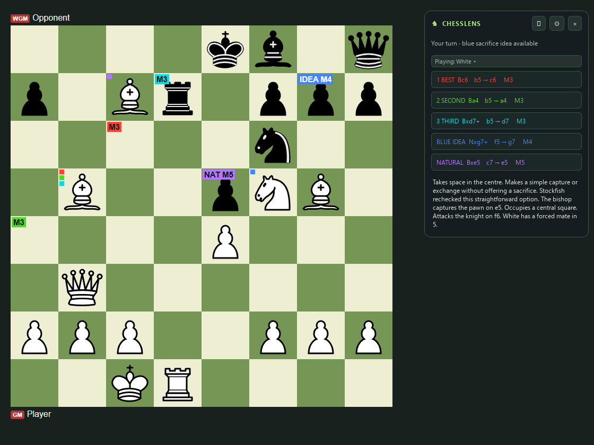

# ChessLens

**Your screen. Your board. Local Stockfish analysis.**

ChessLens is a Windows desktop companion that reads a Chess.com board from your browser and places move markers directly on that board. A small movable panel explains the suggestions. There is no separate main board, and the app never plays moves for you.



## Download and run

1. Open **[the latest release](https://github.com/gracefuligt0/ChessLens/releases/latest)**.
2. Under **Assets**, download **`ChessLens-v1.3.0-Windows-x64.zip`**. Choose the Windows ZIP, rather than GitHub's “Source code” download, if you just want to run the app.
3. Right-click the ZIP, choose **Extract All**, and extract it into a folder you can keep.
4. Open the extracted **ChessLens** folder and run **`ChessLens.exe`**. Keep `_internal` and the connector folders beside it.
5. Connect your browser using the steps below, then refresh your Chess.com tab. Analysis updates automatically as the position changes.

**Requirements:** Windows 10/11, 64-bit. Stockfish is included in the Windows download; no Python installation, subscription or API key is required. The executable is currently unsigned. Release checksums are in `SHA256SUMS.txt`.

## Connect your browser

| Browser | Open in the browser's address bar | What to load |
| --- | --- | --- |
| Chrome | `chrome://extensions` | Enable **Developer mode**, choose **Load unpacked**, select **Browser-Connector** |
| Microsoft Edge | `edge://extensions` | Enable **Developer mode**, choose **Load unpacked**, select **Browser-Connector** |
| Brave | `brave://extensions` | Enable **Developer mode**, choose **Load unpacked**, select **Browser-Connector** |
| Firefox 140+ | `about:debugging#/runtime/this-firefox` | Choose **Load Temporary Add-on**, select `Firefox-Connector/manifest.json` |

Refresh Chess.com after loading the connector. In Firefox, allow the requested Chess.com site access if prompted. This GitHub release is not Mozilla-signed: Firefox's temporary connector needs loading again after Firefox restarts. Chromium connectors remain installed until you remove them or move their folder. Safari and mobile browsers are not supported.

For an update, replace the extracted app folder, reload the connector on the extensions page, and refresh Chess.com. The included `Browser-Connector/SETUP.html` also explains installation. In a source checkout, connector folders are `browser-extension/chromium` and `browser-extension/firefox`.

## What it shows

- **Red, green and cyan:** the engine's top three moves, with evaluation tags and explanations.
- **Blue IDEA:** an optional engine-checked sacrifice or a move setting up a conditional sacrifice plan.
- **Purple NAT:** an optional simpler move, favouring development, central play, castling and sensible exchanges. It is a transparent heuristic, not a model of a person's playing strength.
- **P:** a conservative premove suggestion that remains legal across the checked opponent replies. Nothing is queued or played automatically.
- **Brilliant celebration:** a chime after a qualifying move is actually played, never just because a suggestion appears. This is a local heuristic, not an official Chess.com grade.

Quick suggestions appear first, then the search refines them. The app checks full FEN state against the drawn pieces, preserves turn/castling/en-passant information, and discards stale results. Limited searches can miss tactics. Use the **Playing** control if the detected player colour needs correcting. Screen recognition is also available, but reconnect the browser for an already-running midgame: a screenshot cannot establish missing game history.

## Custom visual titles

Open **Options** in the desktop bubble. Under **Visual title badges**, independently enable a title for **yourself**, **your opponent**, or both. Choose **GM, IM, FM, CM, WGM, WIM, WFM or WCM**. Turn either checkbox off to restore that player's normal title display.

These are local cosmetic badges. They do not edit accounts, ratings, credentials or what your opponent sees. Hover text identifies them as custom ChessLens titles.

## Sounds and controls

**Options** includes sound selection, mute, **Test brilliant sound**, and **Load my WAV sound**. The public download includes an original chime. You can import your own PCM 16-bit mono/stereo WAV, lasting 0.1–20 seconds and under 8 MB. Personal voice clips are not bundled in the public release. The sound is deduplicated and waits for a verified actual move; brief piece animations do not lose the event.

Click a move row for its explanation. Drag the bubble to move it. Use pause/resume or the tray menu for scanning controls, and the cross to quit. Only one desktop instance runs per Windows login session.

## Privacy

Stockfish analysis and screen recognition run on your computer. The connector sends the visible board state and board bounds only to the local desktop bridge at `127.0.0.1:37391`. It does not read account cookies or play moves. No position or screenshot is uploaded to a remote analysis service. Custom audio and calibration stay in your local application data folder. The automatic connector uses Chess.com's internal board API, which may change.

Designed for study, analysis and computer opponents; use analysis assistance where your game's rules allow it.

## Run from source

Use Python 3.12 on Windows:

```powershell
python -m venv .venv
.\.venv\Scripts\python.exe -m pip install -r requirements.txt
.\.venv\Scripts\python.exe scripts\fetch_engine.py
.\.venv\Scripts\python.exe scripts\generate_extensions.py
.\.venv\Scripts\python.exe src\overlay.py
```

The engine fetch verifies the official Stockfish 19 archive and executable using pinned SHA-256 hashes. The repository contains Stockfish's corresponding source and licenses under `src/assets/engine/stockfish`; the large executable is fetched for builds and included in the Windows release ZIP.

To rebuild the portable Windows app and release archives:

```powershell
powershell -ExecutionPolicy Bypass -File scripts\build.ps1
.\.venv-build\Scripts\python.exe scripts\package_release.py
```

The script creates an isolated build environment. `dist/ChessLens` is the portable app, and `release-artifacts` contains the ZIPs and checksums. You may replace compatible Qt/PySide libraries in `_internal` and rebuild/debug modifications; see the component license notices and source links.

Run the regression suite after fetching Stockfish:

```powershell
Set-Location src
..\.venv\Scripts\python.exe -m unittest discover -p "test_*.py"
```

## License

Application code: **GPL-3.0-or-later**. Stockfish is GPL-3.0; bundled cburnett/merida artwork is GPL-2.0-or-later; the original chime is CC0. Qt/PySide and other dependencies retain their own licenses. See [THIRD-PARTY-NOTICES.md](THIRD-PARTY-NOTICES.md), [LICENSE](LICENSE), and [SOURCE.txt](SOURCE.txt). The source release accompanies the binary release.
